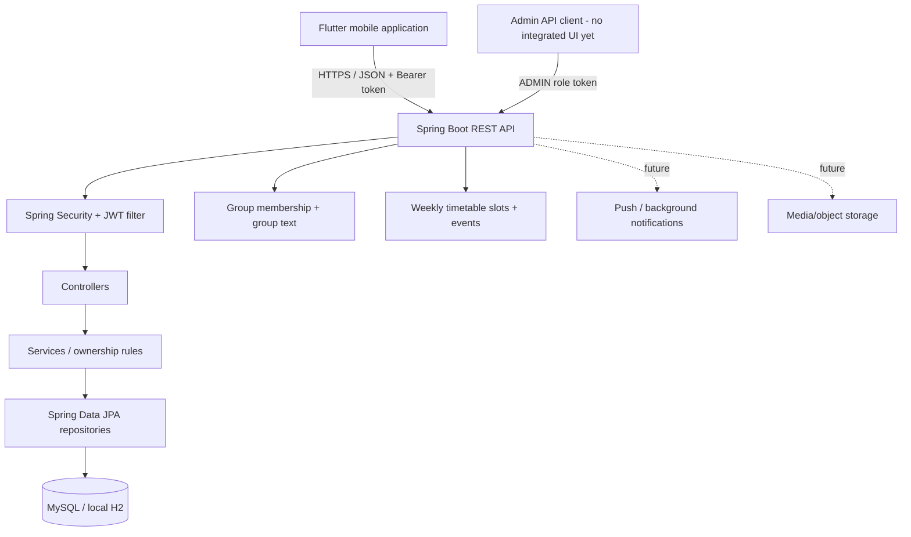

# Architecture

## Active architecture

The active source uses Flutter as the client, Spring Boot as the API boundary, and a relational database for persistence. The former Firebase implementation is retained under `legacy/firebase-v1/` for feature and provenance reference only.

## Mobile client

`mobile/` contains the active Flutter app: sign-in, home/dashboard, faculty search, profile editing, calendar/events, structured timetable editing/viewing, one-to-one chat and group text chat. API calls are centralized in `mobile/lib/services/api_service.dart`. Access tokens are stored through `flutter_secure_storage`; authenticated requests attach an `Authorization: Bearer` header. The API base URL is configurable via `--dart-define=API_BASE_URL=...`; release clients require HTTPS while debug accepts local HTTP hosts.

## Backend

`backend/` is a Java 21 / Spring Boot 3.5.16 service.

- `controller/` — REST endpoints and request mapping.
- `service/` — business rules and owner checks.
- `repository/` — Spring Data JPA access.
- `model/` — relational entities.
- `dto/` — request and response objects; user data leaves the API through `UserResponse` rather than the password-bearing JPA entity.
- `security/` — JWT issuance, verification, principal and bearer filter.
- `config/` — Spring Security, CORS and exception handling.
- `bootstrap/` — optional environment-configured initial administrator.
- `db/migration/` — V1 unified schema and V2 additive schema for token versions, availability, event details, timetable slots and group chat records.

Passwords are BCrypt-encoded (cost 12). Non-public API routes require authentication; admin routes additionally require `ROLE_ADMIN`. Owner-scoped methods use the current authenticated principal rather than trusting user IDs supplied by the client. Password change/logout increment a database token version checked by the bearer filter, invalidating other tokens for that account. Optional `VCOMM_ALLOWED_EMAIL_DOMAINS` restricts login, faculty provisioning and bootstrap admin domains; it does not verify ownership of the mailbox.

## Persistence

The application defaults to local in-memory H2 with the console disabled. MySQL is configurable via environment variables. Flyway V1 defines the unified schema; V2 adds token/availability fields, event scheduling details, structured timetable slots and group messages. Hibernate validates the migrated schema rather than creating tables automatically.

The initial migration is designed for a new database. It is not a data-preserving migration from the earlier plaintext-password V2 schema. Faculty accounts must be re-provisioned or have credentials reset before moving real users.

## Legacy compatibility

Firebase V1 identifies users by Firebase UIDs and stores messages in Firestore document paths. The active V2 relational API identifies users by numeric database IDs and uses different request/response contracts. Do not copy V1 screens or service code directly into the active app; port the desired user experience through the new REST API and relational data model.

## Remaining architecture work

- Group deletion/ownership transfer lifecycle and pagination.
- Attachment metadata and approved object storage.
- Rich message operations (reply, forward, edit/delete, reactions, pin/star, archive).
- Replace current polling with real-time transport only if product requirements justify it; polling is the current documented synchronization strategy.
- Persisted notification preferences and verified background/push delivery flow.
- Integrated admin web interface calling the protected admin API.
- Pagination, rate limiting, audit events and automated security tests.
- Spring Boot 4.x upgrade and compatibility tests before a long-lived public deployment.

The group, timetable and event implementation is merged into `main`. GitHub Actions Run #9 passed the backend tests, Flutter analysis/tests, Android debug build, and iOS simulator build on PR #2's head commit. Those CI checks do not verify production deployment, MySQL operations, physical-device behavior, full end-to-end workflows, or penetration resistance. See [Baseline Verification](BASELINE_VERIFICATION.md).
