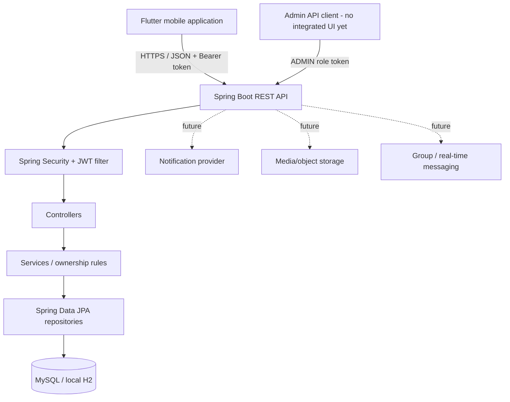

# Architecture

## Active architecture

The active source uses Flutter as the client, Spring Boot as the API boundary, and a relational database for persistence. The former Firebase implementation is retained under `legacy/firebase-v1/` for feature and provenance reference only.

## Mobile client

`mobile/` contains the active Flutter app: sign-in, home/dashboard, faculty search, profile editing, calendar/events and one-to-one text chat. API calls are centralized in `mobile/lib/services/api_service.dart`. Access tokens are stored through `flutter_secure_storage`; authenticated requests attach an `Authorization: Bearer` header. The API base URL is configurable via `--dart-define=API_BASE_URL=...`.

## Backend

`backend/` is a Java 21 / Spring Boot 3.5.16 service.

- `controller/` — REST endpoints and request mapping.
- `service/` — business rules and owner checks.
- `repository/` — Spring Data JPA access.
- `model/` — relational entities.
- `dto/` — request and response objects; user data leaves the API through `UserResponse` rather than the password-bearing JPA entity.
- `security/` — JWT issuance, verification, principal and bearer filter.
- `config/` — Spring Security, CORS and exception handling.
- `bootstrap/` — optional environment-configured initial administrator.

Passwords are BCrypt-encoded (cost 12). Non-public API routes require authentication; admin routes additionally require `ROLE_ADMIN`. Owner-scoped methods use the current authenticated principal rather than trusting user IDs supplied by the client.

## Persistence

The application defaults to local in-memory H2 with the console disabled. MySQL is configurable via environment variables. Flyway migration `V1__create_vcomm_schema.sql` defines the unified schema; Hibernate validates the schema rather than creating tables automatically.

The initial migration is designed for a new database. It is not a data-preserving migration from the earlier plaintext-password V2 schema. Faculty accounts must be re-provisioned or have credentials reset before moving real users.

## Legacy compatibility

Firebase V1 identifies users by Firebase UIDs and stores messages in Firestore document paths. The active V2 relational API identifies users by numeric database IDs and uses different request/response contracts. Do not copy V1 screens or service code directly into the active app; port the desired user experience through the new REST API and relational data model.

## Remaining architecture work

- Group conversation, membership and admin-role domain model.
- Attachment metadata and approved object storage.
- Rich message operations (reply, forward, edit/delete, reactions, pin/star, archive).
- Real-time or explicitly documented push/poll messaging.
- Persisted notification preferences and verified delivery flow.
- Integrated admin web interface calling the protected admin API.
- Pagination, rate limiting, audit events and automated security tests.
- Spring Boot 4.x upgrade and compatibility tests before a long-lived public deployment.

The source has not yet passed a clean build or end-to-end verification; see [Baseline Verification](BASELINE_VERIFICATION.md).
